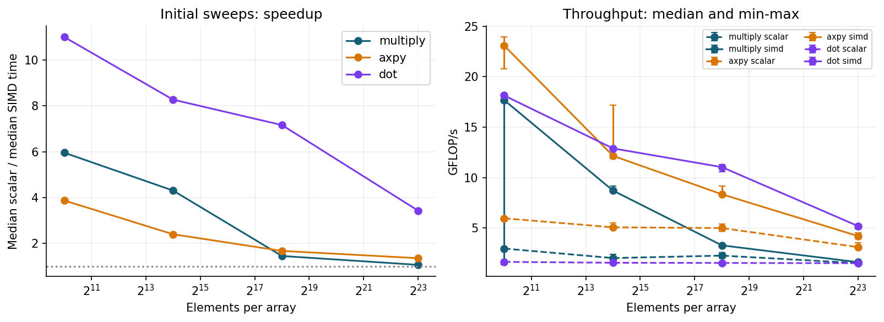
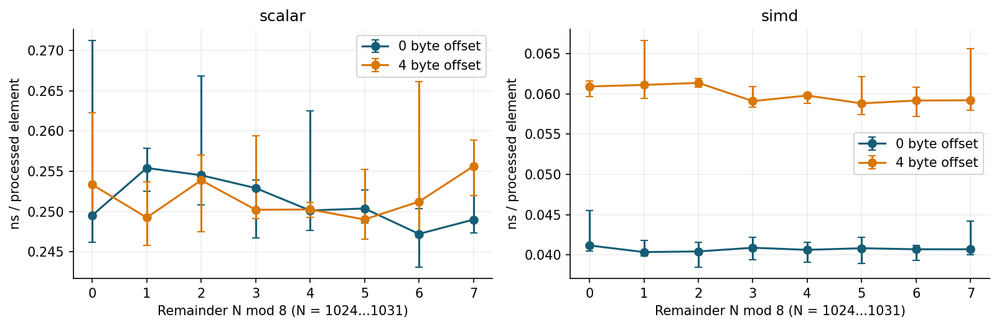
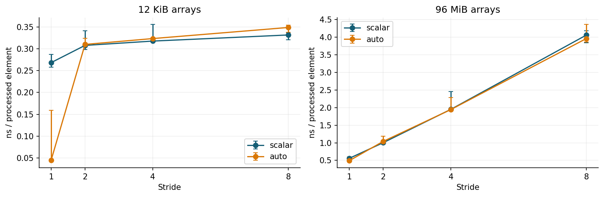
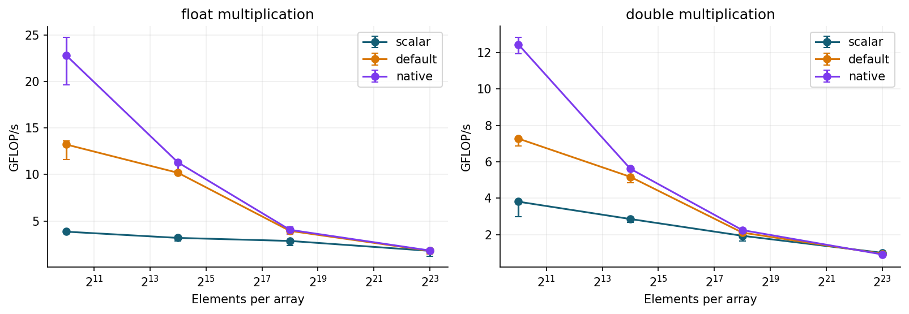
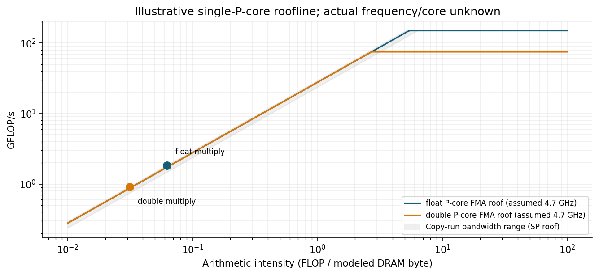

# SIMD Advantage Profiling

**Author:** Khalid Hassen  
**Project:** SIMD Advantage Profiling  
**Course:** ECSE 4320/6320 Advanced Computer Systems

## Objective

The purpose of this project was to measure how SIMD changes the performance of numerical loops and identify situations where vectorization provides little benefit. Scalar and auto-vectorized versions of multiplication, AXPY, and dot product were compared. Additional experiments tested array size, alignment, leftover elements, stride, data type, and compiler target.

**Measurement limitation:** Hardware cycles per element could not be measured because the requested performance-counter events were unavailable in the WSL environment. Runtime, throughput, speedup, and nanoseconds per element are reported instead; these do not replace measured core cycles.

## Expected trends and hypothesis record

The architectural expectations for these experiments are that contiguous SIMD loops benefit most when data is readily available in cache; larger working sets reduce that advantage as data movement becomes limiting. A shifted starting address may add access costs, and lengths not divisible by vector width require remainder handling. Increasing stride should reduce useful cache-line utilization. Double precision permits fewer values per vector and doubles the array footprint at the same element count.

These expectations are stated here to organize the analysis. The available records do not establish a separately saved, pre-experiment hypothesis document, so this section should not be treated as proof that the predictions were recorded before collection. This is a limitation relative to the assignment's pre-experiment hypothesis requirement.

## 1. Method and experimental controls

Three single-threaded kernels were evaluated: elementwise multiplication z = x*y (1 FLOP/element), AXPY y = a*x+y (2 FLOPs/element), and dot product sum(x*y) (approximately 2 FLOPs/element). The original dataset contains 437 successful correctness checks. Allocation, initialization and reference checks are outside CLOCK_MONOTONIC timing; elapsed times include function-call and loop overhead.

| Environment | Recorded configuration |
|---|---|
| Processor | Intel Core i7-12700H; 6 P-cores + 8 E-cores, 20 threads [1] |
| Software | Ubuntu 22.04.3, WSL2 kernel 5.15.133.1; GCC 11.4.0 |
| Power / scheduling | Plugged in; Windows High performance mode (user confirmed). No affinity; actual clock and physical core not recorded. |
| Cache / topology | WSL reports L1d 480 KiB / 10 instances, L2 12.5 MiB / 10, L3 24 MiB. Guest topology is not physical-core proof. |
| Scalar / native | -O3 -march=native, with -fno-tree-vectorize for scalar. |
| Default / dot policy | Default-target multiply: -O3. Both dot kernels: -ffast-math; driver separately compiled without it. No LTO. |

Kernels occupy separate translation units. Returned dot results are accumulated in a checksum; output arrays are checked after timing. Inputs use exactly representable binary fractions in bounded ranges. AXPY validation accounts for all repeated updates, including warmups. These inputs validate the tested calculations, not general numerical stability under fast math.

Initial sweeps use 3 trials per kernel/build/size, 10 warmups, and N/repetition pairs (1024,200000), (16384,20000), (262144,2000), (8388608,100). Later layout, stride and type studies use 5 trials with alternating build order. Type tests use 1,000,000 and 100,000 repetitions for the first two sizes. Copy uses 5 warmups and 100 passes per trial. Exact loops and initialization are in the supplied source.

Analysis uses medians of elapsed times. The metrics are calculated as follows:

$$
\text{Speedup}=\frac{\text{median scalar time}}{\text{median vector-build time}}
$$

$$
\text{GFLOP/s}=\frac{\text{FLOPs per pass}\times\text{repetitions}}{\text{elapsed seconds}\times10^9}
$$

$$
\text{ns per element}=\frac{\text{elapsed seconds}\times10^9}{\text{repetitions}\times\text{processed elements per pass}}
$$

Error bars show the observed minimum and maximum, not confidence intervals. Quartiles and all raw values are retained. For strided loops, the denominator counts only the elements actually processed.

## 2. Baseline speedup and locality



| N | Multiply speedup | AXPY speedup | Dot speedup |
|---|---|---|---|
| 1,024 | 5.96x | 3.87x | 11.00x |
| 16,384 | 4.30x | 2.40x | 8.27x |
| 262,144 | 1.45x | 1.67x | 7.16x |
| 8,388,608 | 1.06x | 1.35x | 3.43x |

Median throughput from the same baseline trials is shown below. Each cell gives **scalar / SIMD GFLOP/s**.

| Elements | Multiply | AXPY | Dot product |
|---|---|---|---|
| 1,024 | 2.969 / 17.681 | 5.967 / 23.090 | 1.648 / 18.138 |
| 16,384 | 2.024 / 8.709 | 5.073 / 12.154 | 1.559 / 12.895 |
| 262,144 | 2.269 / 3.285 | 5.000 / 8.346 | 1.542 / 11.039 |
| 8,388,608 | 1.526 / 1.618 | 3.111 / 4.207 | 1.516 / 5.196 |

Multiply spans 12 KiB, 192 KiB, 3 MiB and 96 MiB across its three arrays. AXPY and dot span 8 KiB, 128 KiB, 2 MiB and 64 MiB across two arrays. These are broad L1/L2/LLC/DRAM-sized working sets, not measured cache-transition thresholds. Four samples cannot locate a precise cache boundary; virtualization and unknown physical-core placement further limit that interpretation.

Multiplication speedup contracts from 5.96x to 1.06x as arrays grow. AXPY contracts from 3.87x to 1.35x. These patterns are consistent with data movement limiting vector gains at large working sets. The independent copy experiment in Section 5 provides a bandwidth reference; no cache-miss or memory-controller counters were available to prove the exact bottleneck.

Dot retains 3.43x speedup at the largest size, while the smallest result is 11.00x. The scalar assembly has a dependent vfmadd231ss accumulation; vector assembly has vfmadd231ps on YMM followed by horizontal reduction. Eight lanes break the scalar reduction into lane accumulations, but the vector loop still has a recurrence. Width alone does not explain a measured gain above eight; clock/core placement, loop overhead and scheduling were not controlled well enough to isolate the excess.

The initial 1024-element SIMD multiply trial at 0.151475 s is retained despite two other trials near 0.0115 s. Later datasets are separate sessions and use different allocation/repetition policies; they are not pooled with the initial sweeps. The incorrectly labeled earlier sweep is archived under data/excluded and never enters calculations.

## 3. Alignment, tails and stride



Layout tests cover N=1024...1031, offsets 0 and 4 bytes, and 1,000,000 passes. Shifting all three array addresses increases SIMD median time by 44-52% at matching N. Address misalignment and split cache-line accesses are a plausible explanation, not a directly measured hardware cause. No stable extra tail penalty is resolved at these sizes after normalizing by processed elements.

A representative excerpt from the multiplication vector loop is:

```asm
vmovups ymm1, YMMWORD PTR [rdi+rax]
vmulps  ymm0, ymm1, YMMWORD PTR [rsi+rax]
vmovups YMMWORD PTR [rdx+rax], ymm0
add     rax, 0x20
```

The 32-byte increment corresponds to eight 4-byte floats processed per iteration. This verifies packed arithmetic in the executed unit-stride path, beyond merely enabling an optimization flag.

Assembly confirms 256-bit vmulps/vmovups for eight floats, a 128-bit four-float tail, then up to three scalar vmulss operations. There is no masked tail and no alignment-peeling loop. vmovups supports both aligned and unaligned addresses; using it does not mean aligned access has no performance advantage.



Stride tests hold allocated length fixed, so useful work decreases as stride increases. Correctness checks include untouched skipped entries. The compiled kernel branches on `stride == 1`; strides 2, 4, and 8 execute scalar `vmulss`, not packed SIMD. For 96 MiB arrays, useful auto-build bandwidth falls from 22.79 to 10.75, 5.74 and 2.82 GiB/s. At these strides, every cache line is still touched while fewer elements are used. This is useful-byte bandwidth, not measured DRAM traffic. The nonunit-stride scalar path is the verified negative example: an auto-vectorized build need not vectorize every runtime path. This result applies to this source and compiler configuration, not to all possible strided implementations.

The relevant assembly checks the runtime stride before selecting a path:

```asm
cmp r8, 0x1
jne 17c8
```

Stride 1 reaches the packed `vmulps` loop. The nonunit-stride path instead contains:

```asm
vmovss xmm0, DWORD PTR [rdi+rax*4]
vmulss xmm0, xmm0, DWORD PTR [rsi+rax*4]
vmovss DWORD PTR [rdx+rax*4], xmm0
add    rax, r8
```

Full evidence: [stride disassembly](evidence/stride_assembly.txt).

## 4. Data type and compiler target



| N | Type | Scalar us | Default us | Native us |
|---|---|---|---|---|
| 1,024 | float | 0.266 | 0.077 | 0.045 |
| 1,024 | double | 0.269 | 0.141 | 0.082 |
| 16,384 | float | 5.142 | 1.609 | 1.450 |
| 16,384 | double | 5.739 | 3.167 | 2.917 |
| 262,144 | float | 91.646 | 66.527 | 64.662 |
| 262,144 | double | 135.591 | 124.396 | 116.722 |
| 8,388,608 | float | 4681.266 | 4675.379 | 4586.107 |
| 8,388,608 | double | 8422.991 | 8917.735 | 9247.992 |

Compiler reports verify default 128-bit and native 256-bit multiply vectors: respectively 4/8 floats or 2/4 doubles. At N=1024, native is approximately 1.72x faster than default for either type. Native float takes about half the time of native double across sizes, consistent with both lane count and byte volume. Same N doubles the working set for double; this study does not isolate arithmetic precision from memory footprint.

At N=8388608, median native float speedup over scalar is only 1.02x. Double native/scalar speedup is 0.91x, with overlapping run ranges and substantial drift. This is an observed session outcome, not evidence that vectorization inherently harms double precision. Default/native comparisons change compiler target and tuning together, not only register width. Default-target measurements here cover multiplication; initial AXPY/dot measurements compare scalar and native builds.

AXPY assembly uses packed FMA; dot does likewise with a final reduction. An FMA counts as two FLOPs per lane. The multiplication kernel uses a multiply only. Missed-vectorization diagnostics in driver allocation, timing and checking code do not invalidate vectorization of the separate kernel.

## 5. Bandwidth and roofline interpretation



A separate native-vectorized copy benchmark reads and writes two 128 MiB arrays. Median useful bandwidth is 17.23 GiB/s (range 14.76-18.39). Assembly shows ordinary cached vmovups stores, not non-temporal stores. Counting a source read, destination write allocation and writeback gives modeled traffic bandwidth 25.85 GiB/s = 27.75 GB/s (range 22.14-27.59 GiB/s). Destination allocation traffic is assumed, not measured. Sustained repeated passes amortize startup, but residual cache/writeback effects remain.

| Quantity | float multiply | double multiply |
|---|---|---|
| Modeled bytes / element | 16 (two reads + allocation + writeback) | 32 |
| Arithmetic intensity | 1/16 = 0.0625 FLOP/byte | 1/32 = 0.03125 FLOP/byte |
| Copy-derived memory reference | 1.735 GFLOP/s | 0.867 GFLOP/s |
| Observed large native multiply | 1.829 GFLOP/s | 0.907 GFLOP/s |

The roofline model is:

$$
P=\min(P_{\mathrm{compute}},B\times I)
$$

Here, $B$ is bandwidth in bytes per second and $I$ is arithmetic intensity in FLOPs per byte. For an explicitly hypothetical single Golden Cove P-core at advertised maximum 4.7 GHz [1], two 256-bit FMA units [2] imply 2 * 8 * 2 * 4.7 = 150.4 SP GFLOP/s or 75.2 DP GFLOP/s. Multiply-only peaks are half these values: 75.2 SP and 37.6 DP GFLOP/s. These are theoretical upper estimates, not measured frequency, sustained throughput or a model of an E-core. The single-threaded roof must not multiply by all CPU cores.

Measured large-array results exceed the median copy-derived line by about 5.5% (float) and 4.6% (double). Both lie within the copy-run modeled bandwidth range. The copy access mix differs from multiplication, and traffic is modeled, so this line is an empirical reference, not a strict machine ceiling. Both kernels are far below the assumed compute ceilings and close to the bandwidth reference, supporting a memory-bound interpretation under these assumptions.

## 6. Limitations, reproducibility and disclosure

Hardware cycles per element remain unavailable. `perf stat` reported `<not supported>` for `cycles:u` and `instructions:u`; the exact output is preserved. Nanoseconds per element are supplied, but no timer ticks, BogoMIPS or advertised turbo rate are mislabeled as measured cycles. Measured cycles per element therefore remain an unmet metric unless the instructor accepts this documented limitation. Whole-process counts would also include allocation, initialization, warmups and checking.

The laptop was plugged in with Windows High performance mode. Actual CPU frequency, turbo residency, temperature, physical core type and competing SMT activity were not recorded. WSL exposed 20 virtual CPUs as 10 cores x 2 threads, while Intel documents a hybrid 6P+8E processor. Cache labels remain approximate. No physical-core affinity was enforced, and the VM host can affect scheduling. These limitations plausibly contribute to variability but do not identify any particular outlier cause.

Only three or five trials were collected per configuration. Range bars are descriptive; no significance tests or confidence intervals are claimed. No outliers were removed. Small alignment/tail loops include call overhead. The fixed-stride study does not measure gather instructions and should not be described as a gather benchmark. Input families are simple and exact; signed, random, cancellation-heavy and exceptional floating-point values were not evaluated.

The repository contains source code, raw measurements, processed tables, plotting scripts, and compiler evidence. Run the following from the repository root after installing the dependencies in `requirements.txt`:

```bash
python scripts/analyze.py
```

This regenerates the summaries and figures from `data/raw/`. The hashes in `processed/raw_sha256.json` identify the preserved raw inputs. To collect a separate new benchmark session on the laptop:

```bash
bash run_all.sh
```

New results are saved under `runs/` without replacing the analyzed data. The script also adds default-target baseline runs for all kernels; those additional AXPY/dot results are not part of the measurements reported here. Build and smoke checks performed on a separate assistant environment were used only for code validation, not for the performance results.

## Conclusion

SIMD provided its largest benefits when the working set was small and the compiler could process contiguous elements in vectors. In the initial multiplication sweep, speedup decreased from 5.96x at 1,024 elements to 1.06x at 8,388,608 elements. This decrease, together with the bandwidth comparison, is consistent with memory movement limiting the large-array case. Alignment affected the small-array vector loop, while leftover-element costs were too small to separate reliably from variability. Runtime strides above one used scalar code, showing why compiler reports and assembly must be checked rather than assuming that optimization flags guarantee SIMD. Float/double results reflected both vector lane count and the amount of data moved.

## AI assistance and student contribution

ChatGPT assisted with benchmark and collection code, troubleshooting, analysis and plotting scripts, interpretation, and drafting this report and the repository documentation. Khalid ran the experiments on his laptop and supplied the raw outputs, compiler diagnostics, disassembly, system information, and power-condition confirmation. Interpretation and debugging were developed with AI assistance; this report does not claim independently authored validation code or an equal division of work.

Specific corrections in the workflow included excluding the mislabeled multiplication sweep, rerunning with explicit size and repetition output, recognizing that non-unit stride used scalar instructions, and retaining the unsupported-counter result rather than estimating measured cycles. The report distinguishes useful-byte bandwidth from modeled traffic and preserves timing anomalies instead of deleting them.

All performance results reported here come from the supplied laptop measurements. Separate assistant-environment checks were for code validation only. The student remains responsible for reviewing the implementation, verifying the submitted claims, and explaining the results.

## References

1. Intel, [Core laptop processor comparison chart](https://www.intel.com/content/dam/support/us/en/documents/processors/core/Intel-Core-Comparsion-Chart.pdf), i7-12700H entry: physical core configuration, cache and advertised maximum clock.
2. Intel, [Intel 64 and IA-32 Architectures Optimization Reference Manual, Volume 1, version 050](https://cdrdv2-public.intel.com/821612/248966-Optimization-Reference-Manual-V1-050.pdf), Table 2-4: Golden Cove vector multiply/FMA execution units.
3. GNU, [GCC 11.4 manual](https://gcc.gnu.org/onlinedocs/gcc-11.4.0/gcc.pdf): compiler optimization, target and floating-point options.
4. *ECSE4320_6320_Class-wide_Projects (2).pdf*, course assignment: Project #1, SIMD Advantage Profiling; common requirements and grading rubric.
5. Experiment records: [raw data](data/raw/), [processed results](processed/), [environment](evidence/environment.txt), and [hardware-counter limitation](evidence/perf_check.txt).
