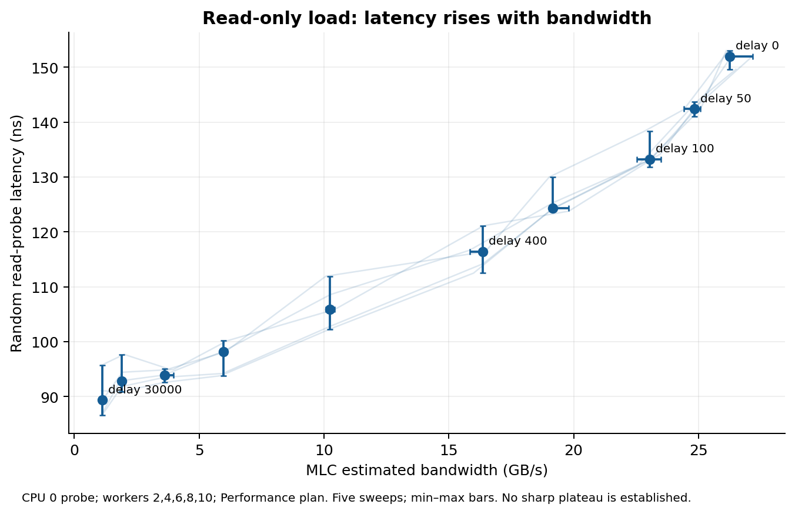

# Cache and Memory Performance Profiling

**Khalid Hassen · ECSE 4320/6320 · Project 2**

This repository studies memory access on a Windows 11 laptop with an Intel Core i7-12700H. It contains the collected data, native benchmarks, counter decoder, analysis code and report.

The main results are a working-set/runtime trend with LLC counters, a read-latency penalty under competing traffic, and a page-locality effect in a dependent pointer chain. The collection includes 360 main MLC observations, 20 instrumented multiplication trials, 50 page-locality trials and 35 global-random cache-latency trials. A separate 50-trial counter attempt contributes valid latency results, while its STLB readings are excluded because they failed validation. Large pages were attempted but allocation failed; reproducible direct TLB-miss counts were not obtained.

Start with [REPORT.md](REPORT.md). See [ENVIRONMENT.md](ENVIRONMENT.md) for hardware and settings, [AI-USE.md](AI-USE.md) for contributions, and [SUBMISSION.md](SUBMISSION.md) for assignment coverage and upload instructions.



## My contribution

I carried out the experiments on my Windows laptop: installed and configured the measurement tools, compiled the native C benchmarks, ran the repeated studies, selected and recorded the power plan, and collected the original logs and traces. I also worked through the large-page and hardware-counter troubleshooting and chose to document the unsuccessful measurements as negative results rather than present them as valid TLB or large-page comparisons.

AI assistance supplied much of the benchmark and analysis code and helped draft the documentation. The division of work and validation details are recorded in [AI-USE.md](AI-USE.md).

## Files

| Path | Purpose |
|---|---|
| `src/cache_kernel.c` | Repeated float multiplication, CPU-0 affinity, QPC timing, result checks |
| `src/cache_latency.c` | Extended global random dependent chain, 32 KiB–128 MiB active footprints |
| `src/page_chase.c` | Seeded dependent pointer chain with packed/spread layouts and explicit page allocation |
| `src/large_page_right.c` | Optional account-right helper used during setup; never run automatically |
| `scripts/build.cmd` | Build the native programs with MSVC |
| `scripts/collect_cache_latency.ps1` | Reconstructed collector for the seven-size global random sweep |
| `scripts/collect.ps1` | Reconstructed experiment collector; new runs remain separate |
| `scripts/analyze.py` | Validate raw observations, rebuild tables and ten PNG/SVG figures |
| `scripts/decode_tlb.py` | Audit the failed 50-trial TLB attempt; zero readings remain explicitly unusable |
| `scripts/decode_counters.py` | Decode WPR counters and bracket timed-loop attribution |
| `scripts/restore_trace.py` | Reassemble the main trace archive from checksummed file parts |
| `scripts/validate.py` | Check archive/source integrity, trace parts, links and output coverage |
| `data/raw/` | Unchanged original logs grouped in per-session ZIPs; trace archives/parts |
| `data/processed/` | Per-trial data, summaries, counter bounds, model table and validation result |
| `plots/` | Ten figures, each in PNG and SVG |
| `docs/` | Session index, command reference, raw checksums and provenance |
| `HYPOTHESES.md` | Readable transcription of the original prediction notes |

The ZIPs inside `data/raw` are intentional raw-data containers. They preserve the original log bytes, including Windows encodings, and reduce the number of files needed for browser upload. The analysis reads them directly. Do not flatten the repository folders or discard these archives.

## Rebuild tables and plots

Use Python 3.10 or later on Windows, Linux or WSL. Analysis is portable; benchmark collection is native Windows.

From the repository root in Windows PowerShell:

```powershell
python -m venv .venv
.\.venv\Scripts\python.exe -m pip install -r requirements.txt
.\.venv\Scripts\python.exe scripts\analyze.py
.\.venv\Scripts\python.exe scripts\validate.py
```

On Linux/WSL, use `.venv/bin/python` in place of `.venv\Scripts\python.exe`. Activation is not required. The plot pipeline uses the supplied, already decoded counter CSV; it does not silently estimate counters if that file is missing. Every successful run regenerates the main per-trial tables, grouped summaries, model table, figures and `data/processed/validation.json`.

Expected main totals are 360 MLC measurements, 20 kernel trials, 50 page-locality trials and 35 global-random cache-latency trials. A separate 50-trial counter attempt contributes valid latency results, while its STLB readings are excluded because they failed validation. Three MLC setup/pilot measurements are separate. Throughput-only MLC zeros are marked as unmeasured latency. Failed/fallback logs remain identifiable in `failed_or_fallback_runs.csv`.

## Independently decode the hardware counters

The 184,549,376-byte main ETL compresses to an archive larger than GitHub's browser per-file limit. That archive is stored as three parts. To reconstruct it and rerun the decoder:

```powershell
.\.venv\Scripts\python.exe scripts\restore_trace.py

.\.venv\Scripts\python.exe scripts\decode_counters.py `
    data\raw\kernel-study-20261020-130137.zip `
    build\traces\kernel_study.etl.zip `
    --output data\processed

.\.venv\Scripts\python.exe scripts\analyze.py
.\.venv\Scripts\python.exe scripts\validate.py
```

Restoration verifies each part and the combined archive. The decoder temporarily extracts the ETL and CSVs, reads event metadata, checks thread continuity/counter deltas/timing placement, and writes `kernel_counters.csv` plus `kernel_counter_summary.json`. It requires the `dissect.etl` dependency in `requirements.txt`. Allow several hundred MiB of temporary disk and memory capacity.

The smaller setup and pilot ETL archives are preserved as additional evidence. They are not used to produce the final kernel-study table. Do not normalize their whole-process counters as if they were timed-loop counts.

## Build and collect new measurements

Install Microsoft's MSVC Build Tools with the **Desktop development with C++** workload. Open an **x64 Native Tools Command Prompt** at the repository root:

```cmd
scripts\build.cmd
bin\cache_kernel.exe 1024 1000000
bin\page_chase.exe 512 4096 10000000 normal
```

Download Intel MLC 3.13 separately. It is not bundled. Administrator PowerShell is used for MLC/WPR collection. The collected CPU mapping is specific to this laptop; inspect your topology before reusing those CPU IDs on another machine.

Examples from Administrator PowerShell:

```powershell
.\scripts\collect.ps1 -Study loaded -SetPerformance
.\scripts\collect.ps1 -Study kernel -SetPerformance
.\scripts\collect.ps1 -Study pages -SetPerformance
.\scripts\collect_cache_latency.ps1
```

Use `-MlcPath 'C:\path\to\mlc.exe'` if needed. Other studies are `cache64`, `cache128`, `spacing`, `pattern-bandwidth`, `pattern-latency`, `single-thread-mixes`, and `mixed`. `-SetPerformance` selects the recorded laptop-specific GUID; on another computer choose an appropriate plan explicitly. The script checks the plan and writes snapshots. It does not reserve CPUs from Windows or lock their frequency.

New measurements go under `runs/`, never into the archived October 20 data. They are not automatically included in the supplied plots. To study another session, deliberately revise the analysis session selection and coverage expectations; do not combine sessions just because file names look similar. Original command lines and delay files remain in the raw archives. The consolidated Windows wrapper was reviewed but has not been executed in its packaged form; I executed the underlying individual commands and C programs on my laptop.

## Large-page result

Normal-page results explicitly report `page_bytes=4096`. MLC first fell back to 4 KiB after `-L`, then asserted after the account privilege was granted. The direct allocator subsequently failed with error 1450. These failures are preserved; no large-page comparison is claimed.

The setup helper changes only the current account's `SeLockMemoryPrivilege` when explicitly run with `--grant`; a new sign-in is then needed. It is unnecessary for reproducing the successful normal-page experiments. `--remove` removes that direct assignment if the user chooses to undo the setup change; it is also never run automatically.

## Interpretation limits

MLC traffic bandwidth is an estimate, sequential latency can include prefetch hits, MLC randomization is block-bounded (the separate native global-random chain is not), early power policy was not bracketed, and Performance does not guarantee a fixed CPU clock. TLB events were attempted but failed repeated validation; the report excludes them from quantitative TLB conclusions. Cache-miss/element is not a conditional miss probability. Counter ranges reflect timing-boundary attribution, not confidence intervals. The report keeps these distinctions explicit and retains anomalous trials.

This package supplies a reproducible analysis of the collected evidence. It does not claim every rubric item is fully satisfied; see [SUBMISSION.md](SUBMISSION.md).

## Counter-validation negative result

The final 50-trial TLB attempt is retained under `data/raw/counter-attempts/`. Its benchmarks passed and its timing data are included in a separate figure. The selected STLB counter stayed flat in every timed benchmark window, although instruction and cycle counts increased. An earlier two-layout pilot produced a signal that was not reproduced by the later counter combination. This does not establish zero TLB misses or an identified cause. See [docs/COUNTER_ATTEMPTS.md](docs/COUNTER_ATTEMPTS.md).

To independently regenerate the failed-attempt audit before rebuilding figures:

```powershell
.\.venv\Scripts\python.exe scripts\decode_tlb.py `
    data\raw\counter-attempts\tlb-study.zip `
    --allow-zero-response --output data\processed

.\.venv\Scripts\python.exe scripts\analyze.py
.\.venv\Scripts\python.exe scripts\validate.py
```

The explicit flag allows export of diagnostic observations; it does not accept the flat event as a valid measurement. Without that flag the decoder rejects this trace as TLB evidence.
