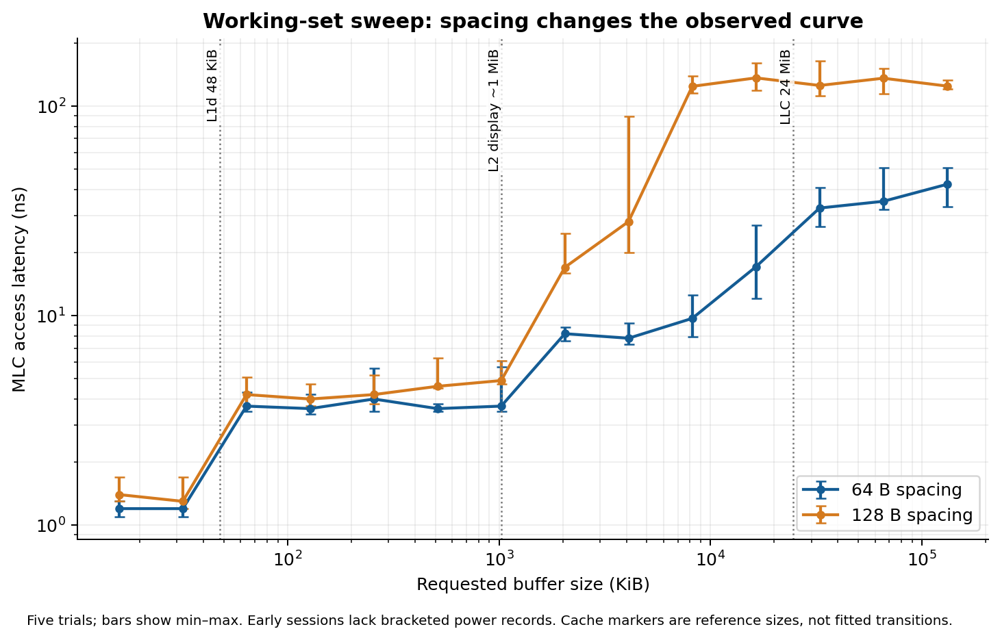
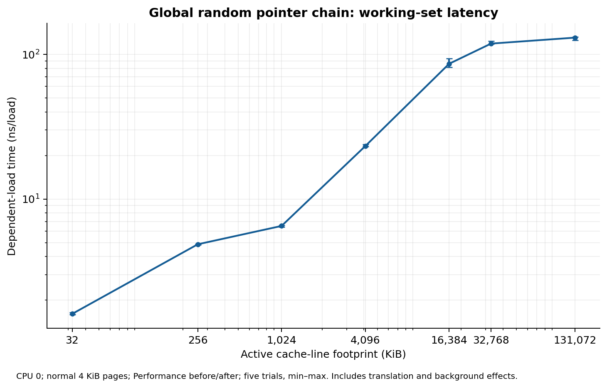
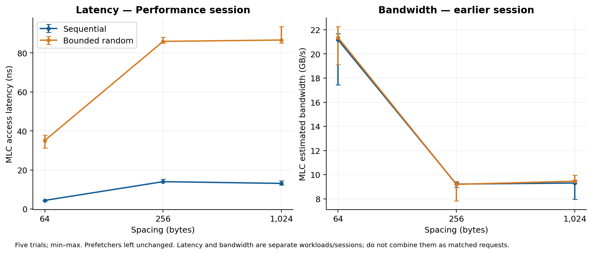
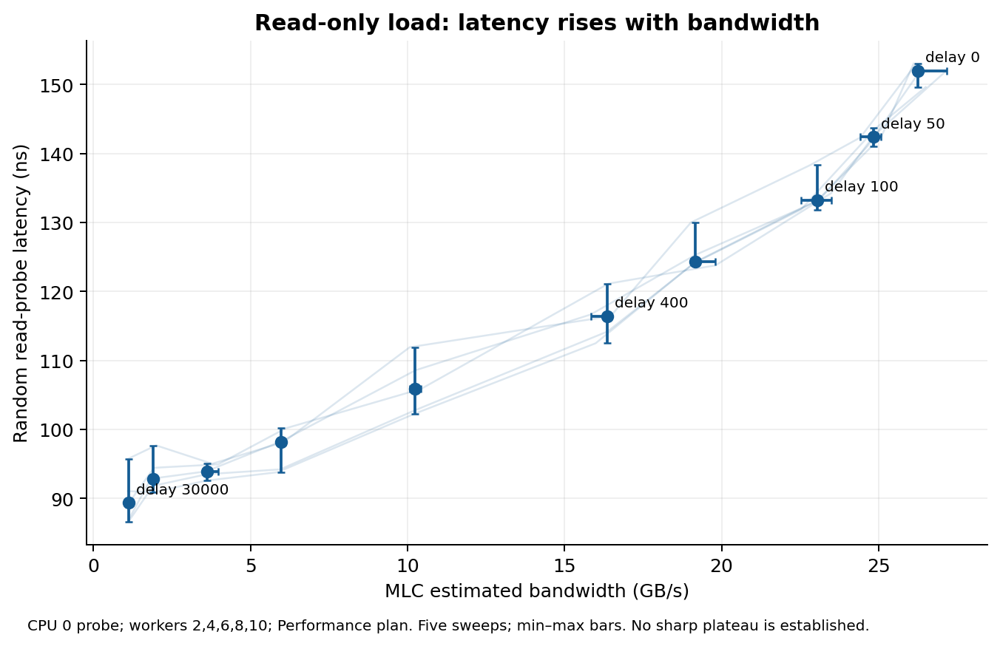
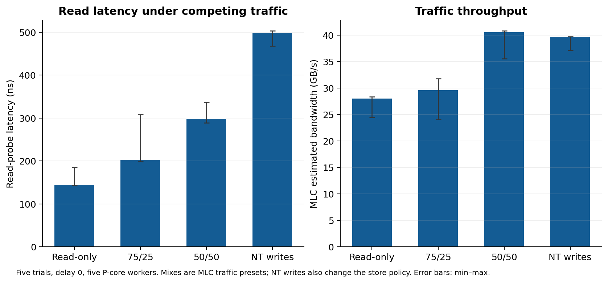
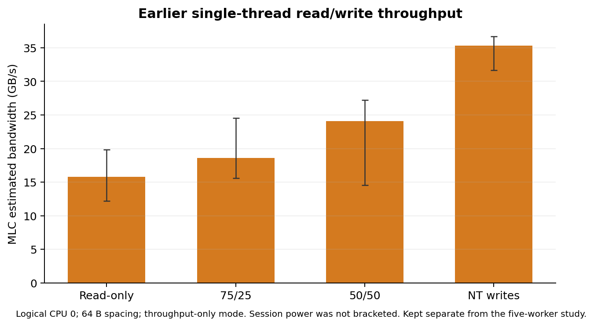
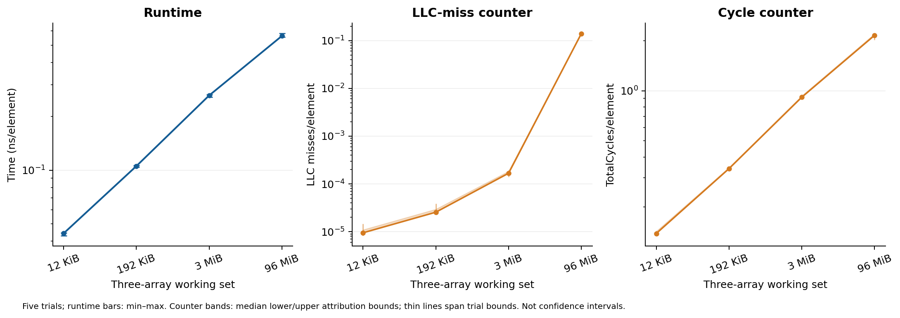
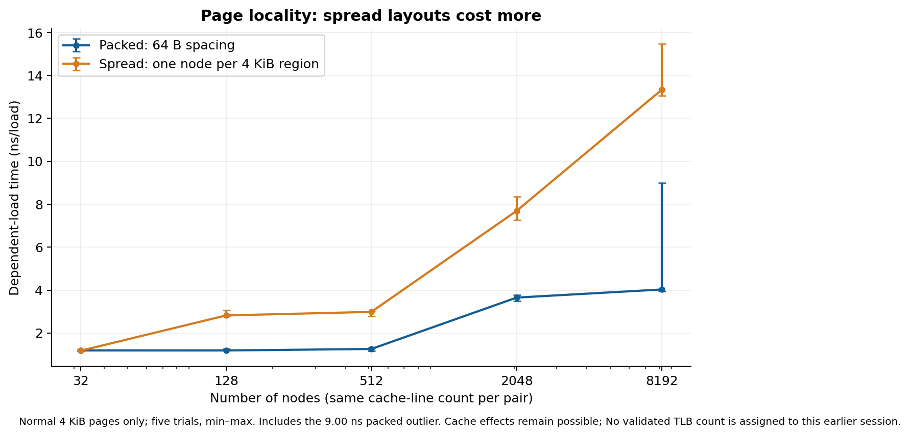
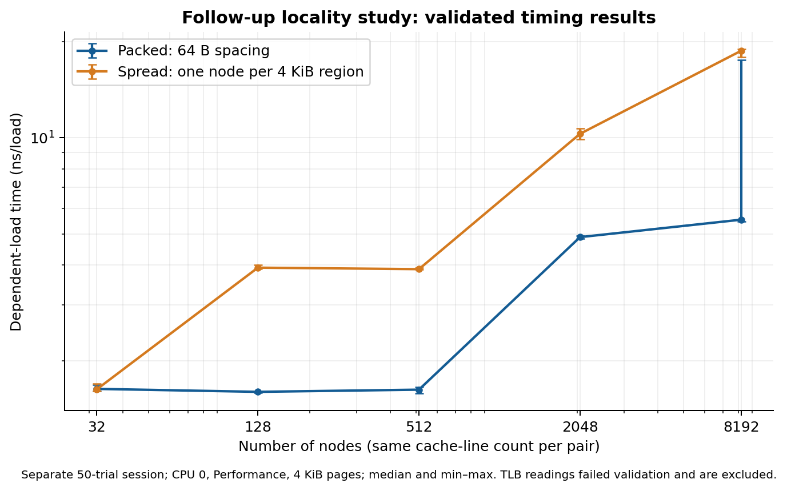
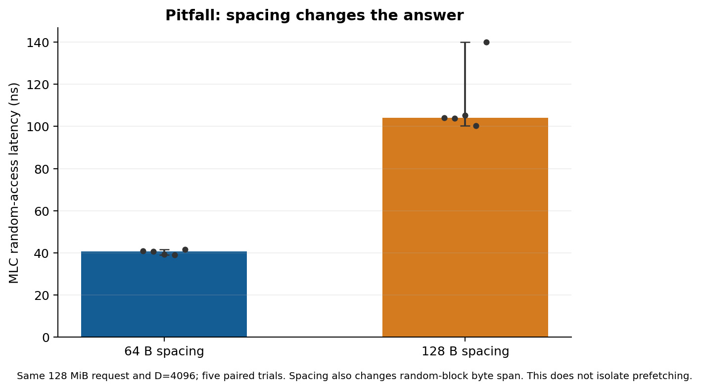

# Project 2 — Cache and Memory Performance Profiling

**Khalid Hassen · ECSE 4320/6320 · Measurements collected October 20, 2026**

## Findings and scope

I measured cache and memory performance on my Intel Core i7-12700H laptop using native Windows tools. Larger multiplication working sets take longer per element and produce substantially more LLC-miss events at 96 MiB. Spreading a fixed number of pointer-chain nodes across more 4 KiB pages also increases dependent-load time. Under competing memory traffic, the read probe becomes slower as throughput increases, and write-heavy traffic raises its latency further.

I collected **360 main MLC observations**, **20 instrumented multiplication trials**, **50 page-locality trials**, **35 global-random cache-latency trials**, and **50 separate follow-up page-locality trials** from the counter attempt. I retained three additional MLC setup/pilot measurements separately; one is a large-page request that fell back to 4 KiB. I preserved failed commands and allocations without counting them as successful trials. I report five-trial medians and observed minimum–maximum ranges, retaining every outlier.

I interpret these results as measurements of observed access paths. I could not fully isolate intrinsic cache and DRAM latency. My direct TLB-counter attempts did not yield reproducible validated counts, large-page allocation failed, and my read-only intensity sweep did not establish a sharp saturation plateau.

## System and method

My laptop runs Windows 11 Home, build 26300, with 16 GiB installed RAM. Coreinfo identifies six SMT-capable P-cores and eight E-cores, a shared 24 MB LLC, and 64-byte cache lines. Logical CPU 0 is a P-core thread; its sibling is CPU 1. Windows reports two 8 GiB modules with configured-speed value 3200. Full topology, tool versions and power evidence are in [ENVIRONMENT.md](ENVIRONMENT.md).

I used MLC 3.13 to measure idle and loaded latency and estimate traffic bandwidth. Its `-e` option leaves hardware prefetcher states unchanged. I compiled the native code with MSVC x64 19.51.36260. I used AI-assisted scripts for the validation, counter decoding and analysis described here; the contributions are disclosed in [AI-USE.md](AI-USE.md). The multiplication kernel uses `/O2 /arch:AVX2 /fp:precise`; the page benchmark uses `/O2`. QueryPerformanceCounter runs at a reported 10 MHz, which is a timer frequency, not CPU frequency. I retained MLC's printed base-frequency clocks without relabeling them as measured core cycles.

I ran the MLC probes with `-c0 -i0`; the native benchmarks explicitly set CPU-0 thread affinity. For loaded and mixed tests, I requested worker CPUs 2,4,6,8,10, one thread on each other P-core, excluding CPU 1. I left SMT enabled. Windows and background applications could still run on these cores; I did not establish OS-wide isolation or a fixed-frequency lock.

My environment snapshot reported the OEM Silent plan. I selected the Performance plan at 12:37 local time. Later main sessions have Performance snapshots before and after collection; the early cache and bandwidth sessions lack equivalent power evidence. After a sign-in reset the policy to Silent, I selected Performance again. I kept sessions with different or unverified settings separate.

My AI-assisted prediction notes anticipated cache-size transitions, a sequential-access benefit, rising latency near bandwidth limits and possible benefits from larger pages. The original notes are transcribed in [HYPOTHESES.md](HYPOTHESES.md). Initial predictions are undated; timestamped later predictions sometimes follow related pilots. This provenance is not stronger than the saved evidence.

## Zero-queue candidates and working-set sweep

I ran two MLC randomized sweeps requesting buffers from 16 KiB through 128 MiB, using 64- or 128-byte spacing. Each condition has five trials. The 128-byte sweep explicitly uses `-D4096`; this bounds randomization in blocks rather than creating one globally randomized cycle. The table gives representative medians, in nanoseconds per MLC iteration.

| Interpretation | Requested buffer | 64 B spacing (ns) | 128 B spacing (ns) |
|---|---|---|---|
| L1 candidate | 16 KiB | 1.2 | 1.4 |
| L2 candidate | 256 KiB | 4.0 | 4.2 |
| LLC candidate | 2,048 KiB | 8.2 | 17.0 |
| DRAM-sized buffer | 131,072 KiB | 42.3 | 124.5 |

The 16 KiB buffer fits the reported 48 KiB P-core L1 data cache. The 256 KiB buffer exceeds L1 but fits the private L2 region, and the 2 MiB request exceeds that L2 display while remaining below LLC capacity. I treat these as candidate residency regions rather than isolated per-level service-time measurements. The L2 marker uses Coreinfo's rounded 1 MB display; it should not be read as a precisely measured capacity boundary.

Spacing substantially changes the curve: the 128-byte sweep is already about 124 ns at an 8 MiB request, well below the reported 24 MB LLC. Buffer size is not the same as uniquely accessed cache-line footprint, and random-block byte span, address conflicts, translation and background/frequency effects can also matter. The cause of that early rise is unresolved. Although a 128 MiB request is DRAM-sized, I do not treat the 42.3 ns result at 64-byte spacing as an unqualified intrinsic DRAM latency. A clean LLC plateau and a universal DRAM latency are therefore not established by these sweeps.

## Global-random dependent-load follow-up

To address the bounded-randomization concern, I ran a separate AI-assisted native benchmark that creates one seeded random cycle across every active cache-line node. It follows one dependent volatile pointer at a time on CPU 0, so the next address depends on the previous load. It warms up with eight full traversals and checks the final pointer after timing. I collected five trials at each of seven active footprints, using ascending size order on odd runs and descending order on even runs. The four smaller sizes use 100 million timed loads; the three larger sizes use 20 million. Both saved power snapshots show Performance.

| Active cache-line footprint | Median ns/load | Observed min–max ns/load |
|---|---:|---:|
| 32 KiB | 1.607 | 1.594–1.640 |
| 256 KiB | 4.865 | 4.810–4.897 |
| 1 MiB | 6.514 | 6.426–6.588 |
| 4 MiB | 23.227 | 23.017–23.876 |
| 16 MiB | 85.991 | 81.136–93.768 |
| 32 MiB | 118.511 | 117.475–123.439 |
| 128 MiB | 130.303 | 125.239–131.740 |

The 32 KiB and 256 KiB footprints are candidate L1- and L2-resident access paths; 4 MiB exceeds the private-cache region while remaining below the reported LLC capacity. The 128 MiB footprint exceeds that LLC capacity. Its median is 130.303 ns/load, about 81 times the 32 KiB result. These are observed dependent-load times, including translation and any background or frequency effects, rather than isolated intrinsic cache/DRAM service times.

Latency already reaches 85.991 ns at 16 MiB, below the reported 24 MB LLC capacity. This is an unresolved result: nominal capacity alone does not establish residency, and the experiment has no matching cache/TLB counters for this pointer-chain session. It does not establish a clean LLC plateau or identify the cause of the rise. I kept the earlier multiplication counters separate because they describe another workload.

All 35 trials passed; analysis recomputes the times from QPC ticks and checks exact size/run coverage. The uploaded source and executable hashes match the collection log. Allocations are rounded to a 2 MiB unit, but the recorded page size is 4096 bytes throughout; the rounded allocation does not turn the small active footprints into 2 MiB working sets or large-page tests. I kept this study separate from the earlier MLC sessions. Raw logs are in `data/raw/cache-latency-20261020-195943.zip`; processed observations and summaries are `data/processed/cache_latency_trials.csv` and `data/processed/cache_latency_summary.csv`.

## Access pattern and granularity

For the later latency comparison, I fixed the request at 128 MiB and compared sequential with bounded randomized access. A separate, earlier bandwidth session uses one CPU-0 traffic worker with AVX2 and throughput-only mode. I show the sessions side by side to compare their trends; their latency and throughput do not describe the same request population.

| Spacing (B) | Sequential ns | Random ns | Sequential GB/s | Random GB/s |
|---|---|---|---|---|
| 64 | 4.4 | 35.1 | 21.17 | 21.36 |
| 256 | 14.0 | 85.9 | 9.22 | 9.19 |
| 1024 | 13.1 | 86.6 | 9.31 | 9.46 |

Sequential access has much lower reported latency, consistent with hardware prefetchers fetching predictable addresses before demand. MLC itself warns that this path can measure prefetched cache hits. Increasing spacing from 64 to 256 bytes lowers throughput substantially; it does not improve further at 1024 bytes. Fewer useful locations per transferred cache line and prefetch behavior are plausible contributors, but controller transactions were not directly counted.

The bounded randomized bandwidth is close to sequential bandwidth at each spacing. I therefore cannot support a blanket prediction that randomized access must always have lower throughput. The bandwidth randomization uses `-U -n4096`, and multiple independent requests and block locality distinguish it from a serial global random pointer chase. Error ranges overlap. Throughput-only MLC output prints zero latency as a placeholder; processed tables mark that latency as unmeasured.

## Throughput–latency tradeoff and Little's Law

I ran five Performance-plan sweeps, alternating ascending and descending injection delays. A randomized CPU-0 probe runs beside five read-only workers with 128-byte spacing and a 128 MiB buffer request per worker. Lower delay increases offered traffic.

Median bandwidth grows from 1.12 to 26.24 GB/s while probe latency grows from 89.36 to 151.99 ns. Gains per successive increase in offered load become smaller near the top of the observed range. From delay 100 to delay 0, median bandwidth rises 13.8% and latency rises 14.1%. Both still change materially, so the curve does not prove that physical bandwidth is saturated.

I selected an **operational near-peak point** using an explicit post-analysis rule: choose the least aggressive tested condition reaching at least 90% of the largest observed median bandwidth. Delay 50 qualifies at 24.85 GB/s (94.7% of 26.24), with 142.38 ns probe latency. This is a practical operating-point convention, not a uniquely identified hardware knee.

Little's Law is `N = lambda * W`, for a consistent population of requests. With 64-byte line-equivalent traffic, a scale model would use `lambda = bandwidth/64`. The final column below is the median, computed per trial, of `bandwidth * probe_latency / 64` after unit conversion.

| Injection delay | MLC GB/s | Probe ns | Equivalent N (model only) |
|---|---|---|---|
| 30000 | 1.12 | 89.36 | 1.6 |
| 400 | 16.37 | 116.40 | 29.2 |
| 100 | 23.06 | 133.23 | 48.0 |
| 50 | 24.85 | 142.38 | 55.3 |
| 0 | 26.24 | 151.99 | 62.4 |

**The equivalent N is not measured outstanding-request concurrency.** Worker request latency is not the probe's measured latency, and the workers and probe use different access paths. Their populations cannot simply be combined into a valid quantitative Little's Law estimate. The table shows the scale that would follow if probe latency represented mean line-request residence time. For the serial dependent probe itself, approximately one request is outstanding, so its ideal request rate scales as `1/W`; loop overhead is also present. Additional worker-latency/occupancy measurements would be needed to identify actual worker concurrency.

## Read/write traffic

At delay zero, the same probe and five-worker placement compare read-only, MLC 75/25 and 50/50 presets, and non-temporal writes. These are read-probe latencies under background traffic, not measured write-operation completion times. MLC estimates expected traffic as seen at the memory controller, including its treatment of read-for-ownership; its ratios are not simply source-level load/store counts. I used and documented the available 75/25 preset without labeling it as exact 70/30.

| Background traffic | Median probe ns | Median MLC GB/s | Observed probe range (ns) |
|---|---|---|---|
| read-only | 144.41 | 28.03 | 143.48–184.94 |
| 75/25 | 201.69 | 29.63 | 198.29–307.96 |
| 50/50 | 297.86 | 40.58 | 288.51–336.71 |
| NT writes | 498.58 | 39.59 | 467.79–502.96 |

Read-probe latency increases strongly under write-heavy load. The 50/50 preset reports the greatest median estimated traffic throughput, while NT writes have the highest probe latency. NT stores change the store policy as well as traffic composition, so this does not isolate read/write fraction alone or prove writes are inherently faster. Higher aggregate bandwidth can coexist with worse latency for a dependent reader.

I retained the earlier single-thread mix study as a separate session and figure. Its unverified power state, CPU count and spacing differ, so I did not pool it with the later results.

## Cache counters and multiplication runtime

The native kernel computes `z[i] = x[i] * y[i]` over three distinct float arrays. Total working set is `12*n` bytes. Ten warmup passes precede one timed repetition batch; initialization, result validation and checksum calculation are outside timing. Correctness checks all elements. Summed output is also checked by the analysis against the known 100-element initialization period. Each size has five trials.

I used WPR to record InstructionRetired, LLCMisses and TotalCycles on context switches. The trace's counter order differs from the XML list; decoding uses metadata. Counts are differenced on the same logical CPU, then attributed to the thread that ran in that interval. Absolute QPC start/end values select the timed loop rather than the whole process. All measurement-overlapping benchmark intervals use CPU 0. The trace reports no lost events or buffers; continuity and nonnegative-delta checks pass.

Some context-switch intervals straddle a QPC boundary. Lower counts include only intervals wholly inside timing; upper counts also include boundary-crossing intervals. The table reports medians of these bounds, normalized by the full `n*repetitions` count. They are attribution ranges, not confidence intervals or full hardware-event error bounds. Interrupt work can still affect attribution. Small miss counts have relatively larger boundary uncertainty.

| Working set | ns/element | GFLOP/s | LLCMisses/element bounds | TotalCycles/element bounds |
|---|---|---|---|---|
| 12 KiB | 0.0443 | 22.59 | 9.49111e-06–1.0943e-05 | 0.139–0.143 |
| 192 KiB | 0.1054 | 9.49 | 2.56005e-05–2.94977e-05 | 0.341–0.345 |
| 3 MiB | 0.2617 | 3.82 | 0.000167364–0.000183965 | 0.916–0.933 |
| 96 MiB | 0.5634 | 1.77 | 0.139991–0.142045 | 2.159–2.202 |

The 96 MiB case has dramatically more LLC misses per element and longer runtime. Runtime also grows between the smaller sizes while LLC misses stay low: LLC misses alone cannot distinguish L1, L2 and LLC hits, whose costs and bandwidth differ. The kernel streams independent work, allowing vector execution, prefetching and memory-level parallelism to overlap latency.

AMAT-style reasoning uses `AMAT = hit_time + miss_probability * miss_penalty`. A larger footprint can increase miss probability and thus access cost. However, LLCMisses per processed element is not a conditional miss probability per LLC reference, and this study lacks the reference counts needed for that denominator. Multiplying the reported miss count by a serial pointer-chase latency would also ignore overlap. I therefore use AMAT qualitatively to explain the runtime trend rather than claim a fitted numerical AMAT.

## Page locality and large-page failure

The page benchmark builds a single seeded random cycle and follows dependent volatile pointers. For each node count, the packed layout uses one 64-byte cache line per node; the spread layout places the same nodes in separate 4 KiB regions. A rotating line offset avoids putting every address into one L1 cache set. Every trial performs 100 million dependent loads on CPU 0 after warmup and verifies its ending node.

| Nodes | Cache-line footprint | Packed ns/load | Spread ns/load | Spread/packed |
|---|---|---|---|---|
| 32 | 2 KiB | 1.188 | 1.177 | 0.99× |
| 128 | 8 KiB | 1.187 | 2.820 | 2.38× |
| 512 | 32 KiB | 1.256 | 2.985 | 2.38× |
| 2,048 | 128 KiB | 3.651 | 7.692 | 2.11× |
| 8,192 | 512 KiB | 4.029 | 13.341 | 3.31× |

The layouts are similar at 32 nodes, but the spread layout is slower from 128 nodes onward. More address translations and page-walk costs are plausible contributors, yet physical cache placement, page-table cache traffic and prefetch behavior are not isolated. This is evidence of a page-locality effect, not a measured TLB miss rate or exact TLB-capacity threshold. No direct TLB event is assigned to this earlier session; the later counter attempts are evaluated separately below. The 8192-node packed trial at 9.00 ns/load is retained alongside its 4.03 ns median.

I attempted a large-page comparison, but allocation did not succeed. Initially MLC `-L` explicitly fell back to 4 KiB. I granted my account Lock pages in memory and signed in again, but MLC then asserted even at a 2 MiB request. The native allocator enabled the privilege and returned Windows error 1450, meaning insufficient system resources. The particular resource shortage is unknown. I do not report a large-page speedup or slowdown, and I distinguish a 2 MiB allocation size from a 2 MiB page size.

## Counter-validation failure and retained follow-up timings

I attempted direct TLB-counter collection using AI-assisted WPR custom PMU profiles. The first STLB-hit and completed-page-walk events remained flat. A custom instruction-control event closely matched the built-in instruction event, showing that at least that custom event could count. A later retired-load STLB-miss pilot produced a signal, but the all-retired-load control remained flat on the benchmark thread. I then ran a five-repeat study using a revised counter combination that added cycles, but it did not reproduce the STLB signal. The cause is unresolved; neither a universal lack of hardware support nor a particular allocation fault is established.

The final study includes five trials for each of five node counts and two layouts. The benchmarks passed correctness checks, both power snapshots show Performance, and the decoder matched process command lines and lifetimes plus initial-thread start records to each CSV's QPC window. All timed benchmark intervals were on CPU 0. The trace contains 437,644 counter-bearing context switches, reports zero lost events/buffers, and has no missing PMC records inside the benchmark windows. Nevertheless, every selected STLB counter delta in those windows was zero, while instruction and cycle counts increased.

**I excluded the TLB readings from quantitative analysis.** I do not report flat readings as measured zero TLB misses. I retained the earlier pilot as an unconfirmed result rather than substitute it for the failed repeated study. Removing the unusable all-load counter and adding cycles changed the counter combination without a new pilot first; that was a flaw in the AI-assisted workflow. The signal's dependence on this change is a diagnostic observation, not a proven cause.

The independent timing checks remain valid. I show this later session separately from the original page-locality trials:

| Nodes | Packed median ns/load | Spread median ns/load |
|---|---:|---:|
| 32 | 1.636 | 1.631 |
| 128 | 1.602 | 3.921 |
| 512 | 1.627 | 3.879 |
| 2,048 | 4.887 | 10.292 |
| 8,192 | 5.542 | 18.727 |

The spread layout again has a higher median from 128 nodes onward, but the counter failure prevents attributing that difference quantitatively to TLB misses. The 8,192-node packed trial at 17.548 ns/load is retained alongside its 5.542 ns median and appears in the min–max bars. The archived traces and profiles document a negative measurement outcome: successful trace creation and correct benchmark output do not prove every selected event is usable. [Counter-attempt details](docs/COUNTER_ATTEMPTS.md) explain the exclusions and reproduction command. The processed audit labels the result `TLB_ZERO_RESPONSE`; an explicit diagnostic-export flag is required to retain the flat readings, and the plotting script uses only the validated latency fields.

## Pitfall and honest anomalies

I ran a paired spacing diagnostic with the requested buffer fixed at 128 MiB and the random-index bound at 4096. Median access time changed from **40.7 ns at 64-byte spacing to 104.1 ns at 128 bytes**, about 2.56 times higher.

A naive interpretation would call the faster result intrinsic DRAM latency or assign the entire change to prefetching. That inference is too strong: spacing changes locality and the random block's byte span. Both curves, the low sequential latencies, and MLC's fallback show why large buffers and an option name alone do not establish what was measured. I retained the 140 ns spacing trial and all other anomalies in the data.

## Reproducibility and remaining limitations

[README.md](README.md) gives build, processing and ETL-decoding commands. The repository contains byte-preserved per-session raw archives, checksummed trace parts, source code, collection scripts, processed tables and PNG/SVG figures. Original source and compiled executable hashes were checked against the supplied archive. I ran the individual collection commands on Windows. The packaged wrapper consolidates those commands but was not itself executed there; AI-assisted Python processing and ETL decoding were run end to end on my submitted data.

Interpretation is limited by unverified power policy for early sessions, variable frequency/background activity, short MLC sampling intervals, unresolved LLC-transition anomalies, bounded randomization, modeled rather than directly measured controller bandwidth, and failure to obtain reproducible validated direct TLB counts or a successful large-page comparison. The observed curve supports a throughput/latency tradeoff, not a definitive physical knee.

## References

- [Intel Memory Latency Checker](https://www.intel.com/content/www/us/en/developer/articles/tool/intelr-memory-latency-checker.html); option and traffic semantics checked against the supplied MLC 3.13 README.
- [Microsoft: Recording PMU events](https://learn.microsoft.com/en-us/windows-hardware/test/wpt/recording-pmu-events).
- [Microsoft: Large-page support](https://learn.microsoft.com/en-us/windows/win32/memory/large-page-support).
- [Microsoft: Windows error codes 1300–1699](https://learn.microsoft.com/en-us/windows/win32/debug/system-error-codes--1300-1699-).
- [Microsoft Sysinternals Coreinfo](https://learn.microsoft.com/en-us/sysinternals/downloads/coreinfo).
- [dissect.etl parser](https://github.com/fox-it/dissect.etl).

I disclose AI contributions and validation provenance in [AI-USE.md](AI-USE.md).
