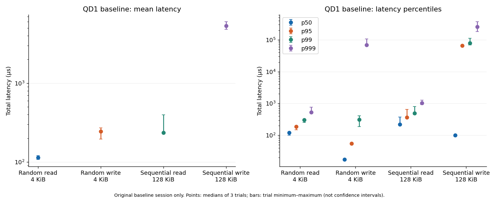
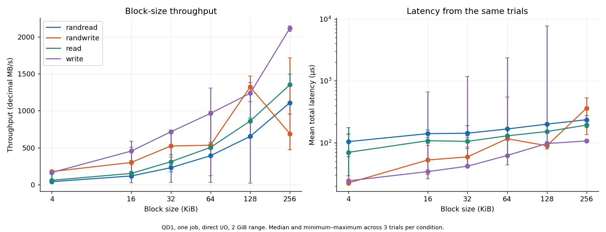
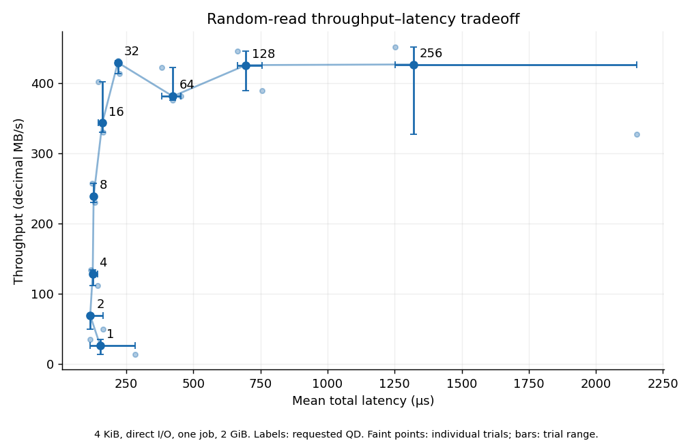
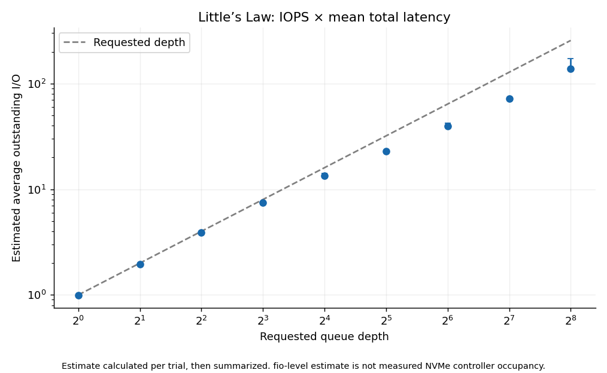
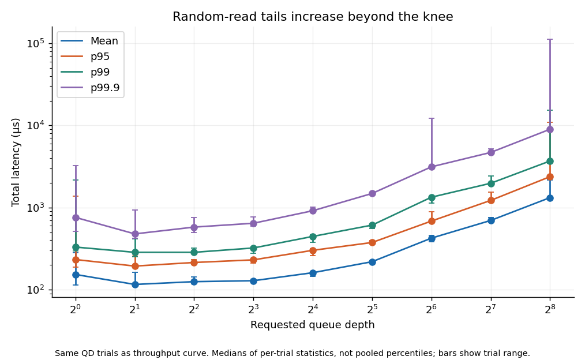
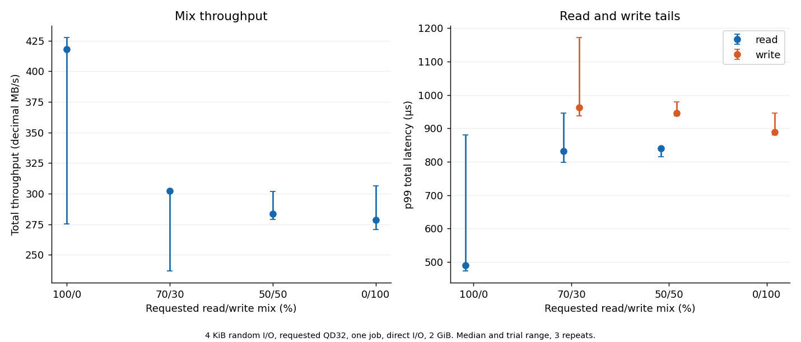
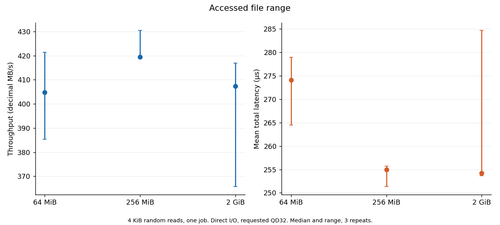
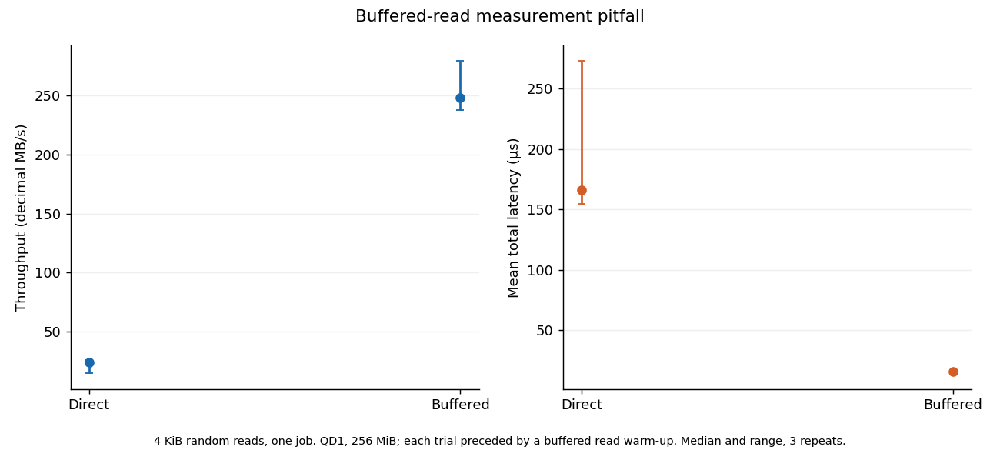
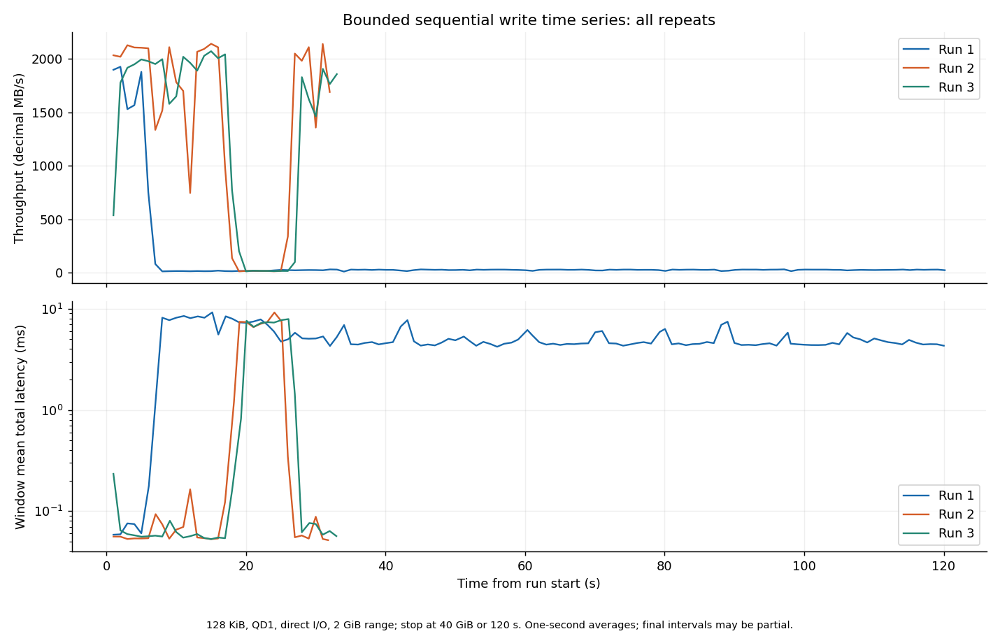

# Project 3: SSD Performance Profiling

**Khalid Hassen · ECSE 4320/6320 · October 24–25, 2026**

## What I measured

I profiled the Micron 2400 NVMe SSD in my Windows laptop using native fio 3.43. I collected **141 main measurements**, with three repeats per condition, plus two read pilots, one preparation/verification job, and six cache warm-up jobs. I used an existing 2 GiB disposable file on C: with direct I/O for the main studies. The buffered comparison was a separate, explicitly labeled pitfall experiment.

My main findings were that larger blocks increased byte throughput in most conditions, random-read throughput reached a practical knee around requested QD32, and higher requested depths substantially increased tail latency without consistent throughput gains. Buffered reads appeared about 10.1 times faster than direct reads in the cache experiment. Sequential write performance varied sharply between sessions and repeats; one bounded write run slowed markedly while the next two recovered. I retain those differences rather than combining every session into one estimate.

## Platform, scope, and safe setup

| Item | Recorded setup |
|---|---|
| SSD | NVMe Micron_2400_MTFDKBA1T0QFM, firmware V3MA003 |
| Physical capacity | 1,024,203,640,320 bytes, approximately 953.9 GiB |
| Platform | Windows 11 Home, version 10.0.26300, build 26300 |
| CPU and RAM | Intel Core i7-12700H; 14 physical cores, 20 logical processors; 16 GiB RAM |
| Volume | C:, NTFS, approximately 928.3 GiB |
| Interface | Windows reported NVMe; Micron identifies the product family as PCIe Gen4 / NVMe 1.4 [3] |
| Tool | Native Windows fio 3.43, windowsaio engine |
| Power | Performance plan before/after each archived study; laptop reported plugged in |
| Test range | 2 GiB file; first 64 MiB / 256 MiB / 2 GiB in range study |
| Temperature | Every archived before/after snapshot returned 60°C; no in-run peak measurement |

Hardware inventory and firmware details above were transcribed from the terminal output I supplied in the project conversation; those original inventory text files were not included in the uploaded experiment archives. Per-study power records, fio version records, and available state JSON snapshots are preserved in `data/raw/`. See [ENVIRONMENT.md](ENVIRONMENT.md) for provenance and unavailable fields.

The volume was nearly full, with roughly 15–19 GiB free across the main archived studies that recorded free space. I did not isolate the SSD from Windows background activity. The measured file range was small relative to the drive and RAM; direct I/O bypassed Windows file buffering but did not remove device caching or controller effects. I did not measure the negotiated PCIe link speed or width.

I used no raw-device writes, partition operations, formatting, or explicit TRIM commands. All write workloads targeted the disposable file. The preparation job wrote and read back 2 GiB using CRC32C verification and reported no error. Later performance jobs checked fio status and short/dropped I/O, but did not independently verify the data after every write workload. The original target was `testfiles/fio-pilot-20261024-225410.bin`; reconstructed replay configs use `testfiles/benchmark.bin`.

## Experimental method and data conventions

All main jobs used one fio job and `windowsaio`. Baseline, block, QD, mix, range, and cache measurements used 20 seconds of timed work after a 3-second ramp. Condition order reversed in the second repeat. The write time-series study deliberately included the beginning of each run with no ramp; each of three sequential-write runs stopped at 40 GiB transferred or 120 seconds, with a 30-second pause between runs. The achieved lengths were therefore unequal.

The fixed and varied settings were:

| Study | Varied | Fixed |
|---|---|---|
| Baseline | Four read/write and random/sequential conditions | QD1; random 4 KiB, sequential 128 KiB; 2 GiB; direct |
| Block sweep | 4, 16, 32, 64, 128, 256 KiB × four patterns | QD1; 2 GiB; direct |
| QD sweep | Requested depth 1, 2, 4, 8, 16, 32, 64, 128, 256 | Random read, 4 KiB, 2 GiB, direct |
| Mix | Requested read/write 100/0, 70/30, 50/50, 0/100 | Random, 4 KiB, requested QD32, 2 GiB, direct |
| Range | 64 MiB, 256 MiB, 2 GiB from offset zero | Random read, 4 KiB, requested QD32, direct |
| Cache pitfall | Buffered vs direct | Random read, 4 KiB, QD1, 256 MiB; buffered warm-up before each trial |
| Write series | Time within each of three runs | Sequential write, 128 KiB, QD1, direct; 2 GiB range; byte/time caps |

Write-bearing studies consistently requested regenerated, non-compressible buffers through `refill_buffers=1` and `buffer_compress_percentage=0`. I did not run an entropy test. Buffer generation and host overhead are part of the measured setup. `end_fsync=1` flushes at job end; it does not make every individual completion a separately forced durable write.

I report decimal MB/s (10^6 bytes/s), binary KiB/MiB/GiB for sizes, and **total fio latency from `lat_ns`** for mean and percentile tables. I keep total latency distinct from completion-only `clat_ns`. Points and tables generally show medians of three per-trial statistics; error bars show their minimum and maximum, not confidence intervals. A median of three p99 values is not the p99 of all requests pooled together. The parsed trial tables retain each run, including p50/p95/p99/p99.9, IOPS, and achieved-depth distributions.

## QD1 baseline

| Workload | MB/s | Mean µs | p50 µs | p95 µs | p99 µs | p99.9 µs |
|---|---|---|---|---|---|---|
| Random read, 4 KiB | 35.69 | 114.09 | 120.32 | 187.39 | 305.15 | 528.38 |
| Random write, 4 KiB | 16.69 | 244.31 | 17.54 | 55.04 | 313.34 | 68,681.73 |
| Sequential read, 128 KiB | 552.28 | 236.48 | 218.11 | 366.59 | 497.66 | 1,028.10 |
| Sequential write, 128 KiB | 24.57 | 5,321.07 | 100.86 | 66,322.43 | 79,167.49 | 254,803.97 |

This is the original baseline session, kept separate from the later block sweep. In particular, write p50 was small while mean and high-percentile latency were much larger. Rare stalls can raise the average above p95, so that ordering is not inherently an arithmetic error. Sequential-write p99.9 was approximately 255 ms in this session. Later write measurements were much faster; I do not present either session as a universal device specification.

## Block size and access pattern

| Block KiB | Random read MB/s | Random write MB/s | Sequential read MB/s | Sequential write MB/s |
|---|---|---|---|---|
| 4 | 39.01 | 175.83 | 57.92 | 163.30 |
| 16 | 116.11 | 299.02 | 150.47 | 453.21 |
| 32 | 228.56 | 522.64 | 309.17 | 714.43 |
| 64 | 390.53 | 533.24 | 503.45 | 964.70 |
| 128 | 652.88 | 1,322.19 | 860.81 | 1,236.64 |
| 256 | 1,108.89 | 689.00 | 1,352.53 | 2,118.55 |

Larger transfers generally increased byte throughput because each operation moved more data. Random-read throughput rose from about 39 to 1,109 MB/s from 4 to 256 KiB, while median mean latency rose from approximately 104 to 236 µs. More bytes per second therefore did not mean faster individual operations. Sequential reads generally outperformed random reads at the same size in this session. The write curves were less regular; for example, random-write median throughput dropped from 128 to 256 KiB.

The complete IOPS and latency summaries are in `data/processed/summary.csv`. The sequential sweep used QD1 only. Its best observed values are results within this experiment, **not established maximum sequential throughput**. The experiment did not include a sequential QD sweep or a random-write QD sweep, so it also does not establish maximum random-write IOPS.

## Queue depth, knee, and Little’s Law

| Requested QD | IOPS | MB/s | Mean µs | p99 µs | p99.9 µs | Estimated L |
|---|---|---|---|---|---|---|
| 1 | 6,498.18 | 26.62 | 152.96 | 329.73 | 757.76 | 0.99 |
| 2 | 16,936.00 | 69.37 | 115.64 | 284.67 | 477.18 | 1.96 |
| 4 | 31,260.29 | 128.04 | 125.03 | 284.67 | 577.54 | 3.91 |
| 8 | 58,252.29 | 238.60 | 128.39 | 321.54 | 643.07 | 7.48 |
| 16 | 83,729.71 | 342.96 | 160.71 | 444.42 | 913.41 | 13.46 |
| 32 | 104,691.32 | 428.82 | 218.71 | 610.30 | 1,482.75 | 22.85 |
| 64 | 92,978.00 | 380.85 | 423.62 | 1,335.30 | 3,129.34 | 39.47 |
| 128 | 103,796.61 | 425.17 | 695.85 | 1,974.27 | 4,685.82 | 72.23 |
| 256 | 104,020.75 | 426.12 | 1,319.93 | 3,686.40 | 8,978.43 | 137.97 |

I identify **requested QD32 as a practical knee for this tested workload**, since it reached the highest median throughput, about 429 MB/s or 104,691 IOPS. Moving from QD16 to QD32 increased median throughput by about 25%. Further depth increases did not consistently improve throughput, while mean and tail latency continued rising. QD256 had nearly the same median throughput as QD32 but approximately six times its mean latency. Individual runs varied, so the knee is an operating-region interpretation rather than a universal controller limit.

Little’s Law relates average requests in a defined system to completion rate and average residence time:

$$L = \lambda W.$$

I compute `IOPS × mean total latency in seconds` separately for each trial, then summarize those estimates. At requested QD32, the median estimate was **22.85 outstanding requests**. Multiplying the displayed median IOPS by the displayed median latency gives approximately 22.90; this small difference follows from summarizing the products separately. At QD256, the corresponding estimate was about 137.97. These fio-level estimates are not direct measurements of NVMe controller occupancy.

Requested QD is a cap, not proof of constant occupancy. fio’s achieved-depth entries are ranges: the 16 bucket includes depths 16–31, and the highest bucket combines depths at least 64 [1]. The full distributions are preserved in `depth_distributions.csv`; I do not infer an exact average by treating bucket labels as exact depths. This is especially important for QD128 and QD256, which share the same top histogram bucket.

Concurrency can keep more storage work available and expose internal parallelism. Once an effective service limit is reached, additional outstanding work can wait longer rather than increase completions per second. The data are consistent with that queueing tradeoff, but I did not measure individual controller stages, firmware scheduling, NAND channels, or host bottlenecks separately.

Micron advertises PCIe Gen4/NVMe capability for the product family and uses fresh-out-of-box QD32 sequential and QD128 random conditions for its published performance [3]. Those conditions differ from my nearly full Windows system volume. I cannot infer PCIe saturation from this throughput plateau; actual link negotiation and competing host/controller limits were not measured.

## Tail latency at mid-QD and near the knee

| Requested QD | p50 µs | p95 µs | p99 µs | p99.9 µs |
|---|---|---|---|---|
| 8 | 136.19 | 230.40 | 321.54 | 643.07 |
| 32 | 203.78 | 374.78 | 610.30 | 1,482.75 |

I use QD8 as a mid-depth point and QD32 as the near-knee point. Throughput increased between them, but p99.9 increased from approximately 0.643 to 1.483 ms. Higher depths worsened tails further: QD256 median p99.9 was approximately 8.978 ms. For a latency-sensitive application, the throughput knee is not automatically the best queue-depth setting; a lower depth may provide a better response-time budget.

## Read/write mixes

| Read/write % | Total MB/s | Read mean µs | Write mean µs | Read p99 µs | Write p99 µs |
|---|---|---|---|---|---|
| 100/0 | 418.19 | 196.46 | — | 489.47 | — |
| 70/30 | 302.12 | 363.78 | 434.67 | 831.49 | 962.56 |
| 50/50 | 283.59 | 378.35 | 441.58 | 839.68 | 946.18 |
| 0/100 | 278.49 | — | 298.68 | — | 888.83 |

Observed operation proportions closely matched the requested mixes. The mixed conditions had higher read latency than the read-only condition. The write-only median p99.9 was approximately 10.158 ms despite a mean near 299 µs. Reads and writes share host and device resources, and writes can interact with internal management work; those are possible mechanisms, not isolated causes in this experiment. Read-only throughput ranged from 275 to 427 MB/s across repeats, so I retain trial ranges rather than interpret small differences as precise effects.

## Working-set range

| Accessed range | MB/s | Mean µs | p99 µs |
|---|---|---|---|
| 64 MiB | 404.82 | 274.08 | 1,269.76 |
| 256 MiB | 419.39 | 254.93 | 913.41 |
| 2 GiB | 407.28 | 254.25 | 774.14 |

Reducing the range did not consistently improve performance. The 256 MiB median throughput was only slightly higher than the other ranges, and the 64 MiB condition had worse p99 latency. This does not establish a cache-capacity boundary or a specific translation/caching mechanism. The physical file remained 2 GiB; only the accessed range changed. This is a logical file-range comparison, not a controlled sweep across known physical NAND locations.

## Misleading setup: buffered reads

Each measurement was preceded by a complete buffered sequential read of the 256 MiB range. `invalidate=0` disabled fio’s explicit pre-run invalidation request. At QD1, buffered random reads had median throughput **248.02 MB/s** and mean total latency **16.03 µs**, compared with **24.52 MB/s** and **166.00 µs** for direct reads. The apparent throughput improvement was approximately **10.1×**.

Presenting that buffered result as uncached SSD performance would be misleading because Windows file caching is permitted. No cache-hit counter was recorded, so I cannot attribute every completion to RAM or give a measured hit rate. Direct reads also do not eliminate device-side caches. The two modes intentionally use different cache policies; the purpose is to demonstrate the setup pitfall rather than rank SSD hardware.

One direct repeat had p99.9 near 12 ms, substantially above the other repeats. I keep it in the trial table and error bars.

## Device state and bounded write time series

| Run | GiB written | Seconds | Average MB/s | Mean µs | p99 ms | p99.9 ms |
|---|---|---|---|---|---|---|
| 1 | 11.67 | 120.017 | 104.36 | 1,245.31 | 66.847 | 111.673 |
| 2 | 40.00 | 31.777 | 1,351.60 | 88.29 | 0.342 | 2.736 |
| 3 | 40.00 | 32.960 | 1,303.08 | 90.48 | 0.436 | 2.605 |

Run 1 stopped at the time cap after 11.67 GiB. Its throughput fell around seconds 6–8: the median of its first five logged bandwidth intervals was approximately 1,877 MB/s, versus about 30 MB/s for the last five. Runs 2 and 3 reached the 40 GiB byte cap in approximately 32–33 seconds and had much higher whole-run throughput. These trials are shown individually, not averaged into a claim of a reproducible steady-state curve.

The slowdown and recovery show that performance depended strongly on the observed run conditions. I cannot identify SLC exhaustion, garbage collection, thermal throttling, background Windows I/O, or another mechanism as the cause. Temperature snapshots were all 60°C and do not show in-run peaks. Free-space snapshots also changed between runs, showing that the system volume was not isolated; the cause of those changes was not measured. A 30-second pause is a repeat-spacing choice, not proof that the device returned to a fresh state.

The one-second latency logs contain window averages, not percentile samples. I use whole-run JSON percentiles for tail summaries [1]. Some final logging intervals are partial, and bandwidth/latency timestamps need not align exactly. Total writes in this study were approximately 91.67 GiB, below the 120 GiB combined cap. Repeatedly overwriting 2 GiB is not full-drive preconditioning, and these measurements do not demonstrate full-drive steady state.

## Validation and reproducibility

Running `python scripts/analyze.py` checks preserved-file hashes, expected trial coverage, recorded settings, fio error status, short/dropped I/O, unintended read/write directions, timing, and IOPS/bandwidth arithmetic before regenerating tables and figures. All **141 main measurements** passed those checks. Including pilots, preparation, and warm-ups, there are **150 fio jobs**.

Fifty jobs across the full archive have a small discrepancy between reported byte counts and counted operations multiplied by block size. For main measurements, each discrepancy is nonnegative and no larger than requested QD times block size. I retain fio’s values and list every case in `validation.json`, rather than silently forcing agreement or claiming a confirmed cause. A passing validation status describes these checks; it does not prove every hardware measurement or written datum is correct.

Original uploaded files are preserved byte-for-byte under `data/raw/`, with SHA-256 and source-archive entries in `manifest.json`. Portable configs and PowerShell replay scripts were reconstructed after collection and are labeled accordingly. They are not represented as the original executed scripts. Replay output is written to separate directories so it does not overwrite or silently pool with the recorded studies.

## Limitations and conclusion

This study measures a small file on a nearly full, active system SSD, not an isolated empty device. There are three repeats per condition, strong session variation, no independent thermal/throttling or garbage-collection counters, no measured negotiated link, and no verified whole-drive steady state. The reported best random-read IOPS and sequential throughput are observed values within the tested workloads, not guaranteed maxima. The original contemporaneous hypotheses file was not uploaded; [HYPOTHESES.md](HYPOTHESES.md) explicitly identifies its reconstructed provenance.

Within that scope, the clearest findings are the throughput/latency tradeoff near requested QD32, growing tail latency at higher depths, the large buffered-I/O pitfall, and the need to retain unstable write behavior rather than replace it with a single favorable run. My results show why queue-depth settings, cache policy, device state, and repeat variation belong alongside headline bandwidth numbers.

## References

1. [fio documentation](https://fio.readthedocs.io/en/latest/fio_doc.html), definitions of total/completion latency, percentiles, queue-depth histograms, direct I/O, and logging. Consulted October 25, 2026; analysis uses recorded fio 3.43 JSON.
2. [Microsoft: MSFT_StorageReliabilityCounter](https://learn.microsoft.com/en-us/windows-hardware/drivers/storage/msft-storagereliabilitycounter), temperature and reliability field definitions.
3. [Micron 2400 product brief](https://www.micron.com/content/dam/micron/global/public/products/product-flyer/2400-ssd-product-brief.pdf), product-family interface and manufacturer test conditions.

AI assistance and my work are disclosed in [AI-USE.md](AI-USE.md).
